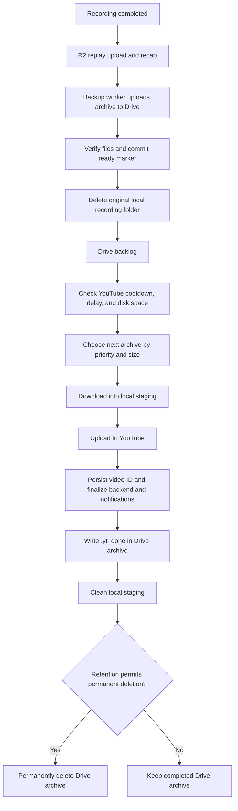

# Recorder Google Drive Buffer — Feature Guide

Status: **Implemented; validated with offline tests. Live Google OAuth/Drive/YouTube and Linux systemd deployment still require an integration smoke test before production enablement.**

For engineering tasks and acceptance tests, see the [implementation plan](RECORDER_GDRIVE_IMPLEMENTATION_PLAN.md).

## Why this feature exists

When YouTube refuses further uploads, completed recordings can accumulate on the server during the cooldown. Google Drive provides an intermediate storage location so the server does not need to keep the entire YouTube backlog locally.

Drive does not bypass YouTube restrictions. The recorder waits for YouTube to become available and uses the official APIs for both services.

## Two operating modes

### Default: direct YouTube upload

With `REC_BACKUP_TO_GDRIVE=false`, preserve the current workflow:

1. Finish recording/remux.
2. Upload replay data and assets through the backend to R2.
3. Send the recap and create `.r2_done`.
4. Upload the local video to YouTube when eligible.
5. Update backend metadata and deliver eligible replay notifications.
6. Mark YouTube completion and remove the completed local recording folder.

### Optional: Drive-buffered upload

With `REC_BACKUP_TO_GDRIVE=true`, the upload service hands post-R2 videos to a **separate GDrive service**. That service hosts the backup worker and, optionally, the Drive-to-YouTube worker. The full flow below requires `REC_GDRIVE_TO_YOUTUBE=true`:



The backup worker can continue evacuating local recordings even while the YouTube worker is paused. A Drive backup counts as a completed **backup**, not a completed YouTube upload.

### Backup only

With `REC_BACKUP_TO_GDRIVE=true` and `REC_GDRIVE_TO_YOUTUBE=false`, stop after the verified archive is stored in Drive and its original local folder is removed. Do not download videos, upload to YouTube, or perform YouTube-related Drive deletion. Archives remain ready with `.drive_ready` and no `.yt_done`. Enable Drive-to-YouTube later to consume this backlog using the same priority rules.

## Accounts and authentication

One Google OAuth application is shared by two separately authorized accounts:

```dotenv
REC_GOOGLE_CLIENT_ID=your_client_id.apps.googleusercontent.com
REC_GOOGLE_CLIENT_SECRET=your_client_secret

# Account A: owns the YouTube channel
REC_YOUTUBE_REFRESH_TOKEN=your_youtube_refresh_token

# Account B: owns the Drive storage; may be different from account A
REC_GDRIVE_REFRESH_TOKEN=your_drive_refresh_token
```

A Google One subscription on account B provides that account's Drive storage. Account A does not need access to account B's Drive because the recorder uses the corresponding token for each service.

Setup command:

```sh
python recorder/auth_gdrive.py
```

The script opens the browser, asks you to select the Drive account and grant consent, obtains offline authorization, creates/reuses the archive root, and prints the Drive refresh-token setting. It will use the same OAuth client credentials as YouTube without replacing the existing YouTube token.

Enable Google Drive API in the Google Cloud project. The permission is `drive.file`, limiting access to files created by or explicitly authorized for the application. Follow current Google consent-screen requirements; applications in Testing can have short-lived refresh tokens for these scopes.

Treat refresh tokens and client secrets as credentials. Do not commit them or include them in operational logs.

## Automatic private folder: JKT48Live

The application creates a folder named **`JKT48Live`** in the selected account's My Drive without sharing it. There is no `REC_GDRIVE_FOLDER_ID` configuration.

The folder is identified by application metadata, not its display name alone. On later runs the application finds and reuses its managed root. Unrelated folders with the same name are not automatically adopted. Ambiguous managed roots or unsafe sharing should require attention rather than arbitrary selection.

Each recording is stored as a child archive folder containing its video, original metadata, available YouTube thumbnail, required notification assets, and application state files. This is a video-replay archive, not a promise to copy every temporary recording part.

Do not manually move or remove managed state files while jobs are running. Do not share the root if recordings are intended to remain private.

## Configuration

New settings:

```dotenv
REC_BACKUP_TO_GDRIVE=true
REC_GDRIVE_REFRESH_TOKEN=your_drive_refresh_token

# Optional second stage; defaults to false (backup only)
REC_GDRIVE_TO_YOUTUBE=false

# Disabled by default to avoid accidental permanent deletion
REC_GDRIVE_DELETE_AFTER_YOUTUBE_UPLOAD=false

# Retain these members even when deletion is enabled
REC_GDRIVE_KEEP_MEMBERS=erine,oline
```

Existing settings reused by Drive-to-YouTube processing:

```dotenv
REC_YOUTUBE_UPLOAD_PRIORITY=erine,oline,fritzy
REC_MAX_CONCURRENT_UPLOADS=1
REC_YOUTUBE_UPLOAD_DELAY_MINUTES=30
```

Lists accept any number of comma-separated nicknames. Matching uses recording metadata `member_nickname`, ignores case and surrounding whitespace, and ignores empty entries, including a trailing comma. Duplicate priority entries retain their first position.

Settings are read at process startup, not continuously reloaded. Restart the relevant service after changing configuration; see the service section below.

## Separate GDrive service

The setup script installs a fourth service without replacing the current services:

| Service | CLI mode | Responsibility |
|---|---|---|
| `mypage48-record` | `record` | Record live streams |
| `mypage48-upload` | `upload` | R2 replay assets/recap; direct YouTube only when Drive backup is disabled |
| `mypage48-theater` | `theater` | Existing theater/checker tasks |
| `mypage48-gdrive` | `gdrive` | Drive backup and optional Drive-to-YouTube processing |

Both Drive workers run inside **one** `mypage48-gdrive.service`; there is no separate Drive-to-YouTube systemd service. Drive-specific code lives in `recorder/src/gdrive/`.

| Master `REC_BACKUP_TO_GDRIVE` | `REC_GDRIVE_TO_YOUTUBE` | GDrive service behavior | Existing upload service |
|---|---|---|---|
| `false` | Either | Alive but idle; no Drive API calls, transfers, or deletion | Normal R2 and direct YouTube |
| `true` | `false` | Verified backups only; stop at Drive storage | R2/recap, then leave videos for GDrive service |
| `true` | `true` | Backups plus priority-based Drive-to-YouTube pipeline | R2/recap, then leave videos for GDrive service |

A service may show `active (running)` while its processing is disabled by configuration. The disabled controller stays alive without requiring Drive credentials, creating a folder, or repeatedly exiting. Starting systemd does not override configuration.

Service commands:

```sh
sudo systemctl status mypage48-gdrive
sudo systemctl restart mypage48-gdrive
sudo journalctl -u mypage48-gdrive -f
```

GDrive logging follows `REC_LOG_MODE`, just like the existing loggers. With `stdout`, worker logs appear in the terminal; the dedicated systemd service redirects its stdout/stderr to `recorder/logs/gdrive.log`. With `file`, Python writes GDrive worker logs directly to `<REC_LOGS_DIR>/gdrive.log`. In `all` mode with `stdout`, GDrive logs share the process output with the other workers; use `file` for separate logger files. Use the file for detailed worker output; systemd journal output may primarily contain service lifecycle messages.

Upload and GDrive services stop accepting work on shutdown and drain admitted jobs; `TimeoutStopSec=30min` is currently commented out in the setup script, so they use the server's default systemd stop timeout. If a transfer exceeds that limit, systemd may terminate it, so inspect recovery checkpoints before restarting ambiguous uploads. Initial deployment must also restart the record service so it loads the shared recording/cleanup lock.

When changing `REC_GDRIVE_TO_YOUTUBE`, restart `mypage48-gdrive`. When changing `REC_BACKUP_TO_GDRIVE`, safely stop/drain active upload jobs, then restart **both** `mypage48-upload` and `mypage48-gdrive` so routing settings agree. If the master is enabled but the GDrive service is stopped, post-R2 videos wait locally; they are not deleted or sent directly to YouTube as a fallback.

For single-process development, `--mode all` also includes the GDrive controller and respects the same switches. Do not run it alongside the split services. Record-only and theater-only modes never start Drive workers.

## Existing YouTube code is reused

The new worker orchestrates Drive discovery, download, and cleanup, but calls the existing YouTube upload implementation under `recorder/src/upload/`. It does not contain a copied YouTube uploader. Title/description formatting, privacy rules, thumbnails, playlists, backend updates, and notification eligibility use the existing implementations.

Any required shared hooks must remain backward compatible. With Drive disabled, the existing direct-upload workflow must behave as before and require no Drive credentials. Regression tests are part of the implementation plan.

## Priority means download priority

Given:

```dotenv
REC_YOUTUBE_UPLOAD_PRIORITY=erine,oline,fritzy
```

The worker inspects metadata for ready, unfinished Drive archives and selects in this order:

| Position | Member | Video size |
|---|---|---|
| 1 | Erine | 2 GB |
| 2 | Erine | 500 MB |
| 3 | Oline | 3 GB |
| 4 | Oline | 800 MB |
| 5 | Fritzy | 1 GB |
| 6 | Any other member | 5 GB |
| 7 | Any other member | 2 GB |

The Oline 3 GB video does not overtake the Erine 500 MB video. Nickname ranking is the first criterion; size is the second.

If no Erine or Oline archive is pending, Fritzy becomes the first group immediately. The worker does not wait for absent members. With an empty setting, all pending archives are ordered by largest video first.

This selection happens **before downloading the media**, using small archive metadata. It does not first download every priority member's videos. Running jobs are not interrupted by a new higher-priority archive.

R2 ordering remains unchanged.

## Concurrency, delay, and server disk usage

A Drive-to-YouTube slot covers downloading, uploading, and finalizing one archive. With concurrency `1`, only one job is active at a time; the worker does not download the next archive during the current upload or its following delay.

The delay starts after successful completion. For example, a value of `30` waits 30 minutes before admitting the next job. With higher concurrency, already active jobs can overlap; use `1` when strictly sequential processing is required.

The backup worker has its own bounded transfer pool, using the same concurrency setting as its independent limit. Calls through the shared Drive API client are serialized for thread safety; the setting is an upper bound, not a promise of parallel Drive transfers. Thus concurrency `1` can allow one backup and one Drive-to-YouTube job simultaneously; it is not a global one-transfer network limit.

Before downloading, the worker checks and reserves disk space for the video plus a safety margin. If insufficient, it pauses instead of filling the disk. Staged video is removed as soon as its YouTube ID is durably checkpointed. Failed jobs also remove their staged media instead of accumulating copies outside the concurrency limit; retries re-download verified bytes, reusing a valid resumable URI when available. On restart, managed stale staging directories are cleared before scheduling. Small durable control records remain available for crash recovery.

This limits backlog storage on the server, but cannot guarantee the disk never fills. Active recordings, failed remux parts, unavailable/full Drive, or recording throughput exceeding backup throughput can still consume local disk. Monitor both local free space and Drive capacity.

## Completion markers and retained archives

The current local marker name is `.yt_done`. The new workflow also creates a file with that exact name **inside the Drive archive folder**.

Its content records the YouTube video ID, archive identity, completion time, and the retention decision (`keep` or `delete`) with its reason. The retention decision is evaluated when YouTube finalization completes. The worker excludes completed archives from future upload candidates, including after restarting the server or rebuilding its local queue.

An archive is only ready for consumption after its `.drive_ready` marker has been committed and its required files verified. Incomplete backups cannot enter the YouTube queue.

The YouTube ID is checkpointed before follow-up operations. A failed backend update should resume finalization for the existing video rather than upload the video again. No external upload workflow can guarantee exactly-once behavior across every possible crash without reconciliation; ambiguous upload results must be surfaced rather than blindly retried.

## Permanent deletion and exceptions

| Delete-after-upload setting | Nickname in keep list | Result |
|---|---|---|
| `false` | Either | Keep the folder with `.yt_done` |
| `true` | Yes | Keep the folder with `.yt_done` |
| `true` | No | Create/verify `.yt_done`, then permanently delete the archive |

A marker is created before deletion even for disposable archives. If deletion fails, the remaining folder is already marked complete and can be retried for **cleanup only**, not uploaded again.

Deletion is **permanent**, not a move to Trash. It removes the managed archive folder and its contents, not the `JKT48Live` root. Retention exceptions preserve the whole archive, not just the video.

**Retention is non-retroactive: an archive retained at completion stays retained.** If Erine was exempt when 20 archives completed, removing Erine from `.env` and restarting the worker will not delete those 20 folders. Their `.yt_done` receipts retain the `keep` decision, and they remain excluded from YouTube uploads. Only future completions use the changed configuration. Similarly, enabling deletion later does not remove archives previously kept while deletion was disabled.

Cleanup retries are allowed only for archives explicitly marked `delete`. If current configuration now protects a pending-deletion archive, the worker records a permanent `keep` decision instead. Receipts with missing or invalid retention decisions are preserved for review, not deleted. Removing previously retained archives requires an explicit manual action outside automatic cleanup.

Changing privacy or retention settings does not re-upload completed videos. Deleting a video manually on YouTube does not automatically clear the Drive completion receipt or trigger re-upload.

## Failure behavior

| Failure | Intended behavior |
|---|---|
| Drive upload interrupted | Resume/reconcile partial archive; keep local source |
| Drive full or token invalid | Pause backups, report failure, keep local files |
| Remote checksum/size mismatch | Do not mark ready or delete source |
| Recording reconnects during backup | Recheck status; do not delete an active source |
| YouTube credentials absent/invalid | Pause YouTube work; healthy Drive backups can continue |
| YouTube quota/upload limit | Keep Drive source, respect the existing 24-hour cooldown, do not download more videos |
| Temporary YouTube network failure | Remove staged media, then retry from verified Drive bytes with resumable state when valid |
| Prolonged cooldown | Permit staged media cleanup; keep Drive source and reconcile session state |
| Backend finalization fails | Retain the successful video ID and retry finalization |
| Drive completion marker cannot be saved | Retain recovery state; do not permanently delete archive |
| Permanent Drive deletion fails | Retry cleanup only; never re-upload completed archive |
| Server restarts | Reconcile journal, manifests, ready markers, and completion receipts |

The GDrive service logs a warning immediately when YouTube quota is exhausted, then an INFO reminder with the remaining cooldown at most once every **6 hours**. After restart, an existing active cooldown is reported once when observed; reminders then follow the same interval. A single INFO message reports cooldown expiry and queue checking, without claiming that an upload has already started. Backup-to-Drive work continues independently.

YouTube playlist/thumbnail behavior and replay-notification eligibility should remain consistent with the current recorder. The buffering feature must not make private/unlisted or official recordings suddenly eligible for public replay notifications.

## Turning the feature off

Setting `REC_GDRIVE_TO_YOUTUBE=false` and restarting the GDrive service pauses the second stage, including YouTube finalization and related remote cleanup, while backups continue. Pending jobs/checkpoints remain available for later resumption; no new `.yt_done` is created merely because an archive was backed up. Drain/checkpoint active jobs safely during the restart.

Setting `REC_BACKUP_TO_GDRIVE=false` and restarting both routing services stops all Drive processing, including backups, scanning, downloads, and automated deletion. The GDrive service may remain active but idle. Pending Drive archives remain in Drive. Local recordings return to the existing direct-YouTube workflow.

Re-enable the feature to resume the Drive backlog. Do not assume disabling the feature copies all pending Drive archives back to the server.

Initially run one existing upload-service instance and one GDrive-service instance on the same server. Role-specific locks allow these two services to coexist but prevent duplicate consumers and overlapping `all` mode. Multiple servers consuming the same Drive backlog require a separate distributed coordination design.

## Google One limits and account safety

Google One increases storage capacity; it does not promise unlimited API calls, upload bandwidth, downloads, or YouTube uploads. Account storage is shared with other Google services. Review current Google documentation and account-specific limits before production use; historical numeric quotas are not a guarantee.

Official API automation is not inherently prohibited, but no implementation can guarantee an account will never be restricted. Respect rate limits, use backoff, and do not rotate accounts/projects to evade YouTube limits.

Only archive and redistribute content you have permission to use. Private Drive folders and private/unlisted YouTube videos do not exempt content from copyright rules, takedowns, or platform policies, especially for paid/member-only live streams.

## Initial rollout checklist

1. Enable Drive API and finish OAuth setup using the intended Google One account.
2. Confirm `JKT48Live` is private and has sufficient storage.
3. Keep permanent deletion disabled.
4. Start the GDrive service with the master disabled and verify it stays active but idle. Then test backup-only mode with tiny videos and concurrency `1`, followed by enabling `REC_GDRIVE_TO_YOUTUBE`.
5. Verify local files are deleted only after a verified Drive backup.
6. Verify nickname priority determines which archive is downloaded first.
7. Verify successful retained archives contain `.yt_done` and are skipped after restart.
8. Test quota pause, low disk space, interrupted transfers, and token failures.
9. Test permanent deletion only on a disposable archive, including a retention exception.
10. Enable production use after reviewing logs and recovery behavior.
