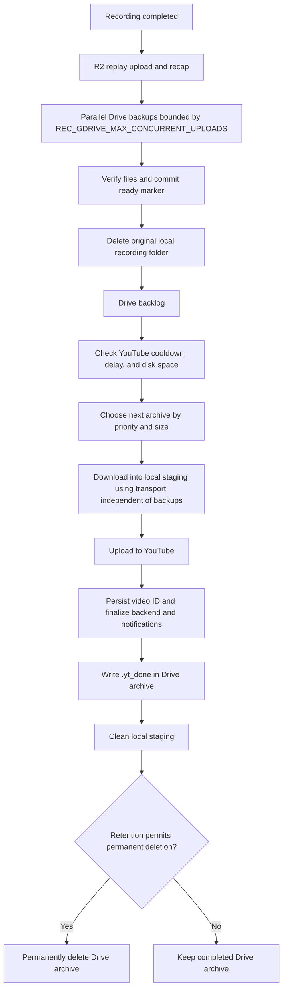

# Recorder Google Drive Buffer — Feature Guide

Status: **Implemented; validated with offline tests. Live Google OAuth/Drive/YouTube and Linux systemd deployment still require an integration smoke test before production enablement.**

For engineering tasks and acceptance tests, see the [implementation plan](RECORDER_GDRIVE_IMPLEMENTATION_PLAN.md).

## Why this feature exists

When YouTube refuses further uploads, completed recordings can accumulate on the server during the cooldown. Google Drive provides an intermediate storage location so the server does not need to keep the entire YouTube backlog locally.

Drive does not bypass YouTube restrictions. The recorder waits for YouTube to become available and uses the official APIs for both services.

## Two operating modes

### Default: direct YouTube upload

With `REC_BACKUP_TO_GDRIVE=false`, preserve the current workflow:

1. Finish recording/remux.
2. Upload replay data and assets through the backend to R2.
3. Send the recap and create `.r2_done`.
4. Upload the local video to YouTube when eligible.
5. Update backend metadata and deliver eligible replay notifications.
6. Mark YouTube completion and remove the completed local recording folder.

### Optional: Drive-buffered upload

With `REC_BACKUP_TO_GDRIVE=true`, the upload service hands post-R2 videos to a **separate GDrive service**. That service hosts the backup worker and, optionally, the Drive-to-YouTube worker. The full flow below requires `REC_GDRIVE_TO_YOUTUBE=true`:



The backup worker can continue evacuating local recordings even while the YouTube worker is paused. A Drive backup counts as a completed **backup**, not a completed YouTube upload.

### Backup only

With `REC_BACKUP_TO_GDRIVE=true` and `REC_GDRIVE_TO_YOUTUBE=false`, stop after the verified archive is stored in Drive and its original local folder is removed. Do not download videos, upload to YouTube, or perform YouTube-related Drive deletion. Archives remain ready with `.drive_ready` and no `.yt_done`. Enable Drive-to-YouTube later to consume this backlog using the same priority rules.

## Accounts and authentication

One Google OAuth application is shared by two separately authorized accounts:

```dotenv
REC_GOOGLE_CLIENT_ID=your_client_id.apps.googleusercontent.com
REC_GOOGLE_CLIENT_SECRET=your_client_secret

# Account A: owns the YouTube channel
REC_YOUTUBE_REFRESH_TOKEN=your_youtube_refresh_token

# Account B: owns the Drive storage; may be different from account A
REC_GDRIVE_REFRESH_TOKEN=your_drive_refresh_token
```

A Google One subscription on account B provides that account's Drive storage. Account A does not need access to account B's Drive because the recorder uses the corresponding token for each service.

### Google Cloud setup

Complete these steps before running the authorization script:

1. Select the same Google Cloud project that owns the existing YouTube OAuth client.
2. Open **APIs & Services → Library**, search for **Google Drive API**, open that API, and click **Enable**. Confirm its status is **Enabled**. Do not choose Google Drive MCP, Drive Activity, Drive Labels, or Cloud Storage; they are not required. Leave YouTube Data API v3 enabled.
3. Open **Google Auth Platform → Data Access → Add or remove scopes**.
4. Find the exact scope `https://www.googleapis.com/auth/drive.file`. Its description refers to viewing, editing, creating, and deleting only the specific Drive files used with the app.
5. **Check the checkbox on the scope's row.** Typing the URL in the filter only finds the row; it does not select it. If the row is available, leave **Manually add scopes** empty. If it is missing, refresh after enabling Drive API or enter the full URL under **Manually add scopes** and click **Add to table**, then select it as needed.
6. Click **Update**, confirm the existing `youtube` and `youtube.upload` scopes are still selected on the Data Access page, then click **Save**. Do not remove the YouTube scopes or add the broader full-Drive scope (`.../auth/drive`). The `drive.file` scope is classified as non-sensitive.
7. If the app's audience is in **Testing**, add the intended Drive account as a test user. Review Google's current refresh-token lifetime rules before using a Testing app for long-running workers.

Enabling Drive API and adding `drive.file` do **not** require replacing the existing YouTube refresh token or creating another OAuth client. Keep `REC_GOOGLE_CLIENT_ID`, `REC_GOOGLE_CLIENT_SECRET`, and `REC_YOUTUBE_REFRESH_TOKEN` unchanged. Declaring a scope in the console does not grant that permission to an existing token: obtain a separate Drive token through the script below.

### Authorize the Drive account

From the repository root, using the recorder Python environment:

```sh
python recorder/auth_gdrive.py
```

The script opens the browser, asks you to select the Drive account and grant consent, obtains offline authorization, creates/reuses the archive root, and prints the Drive refresh-token setting. It will use the same OAuth client credentials as YouTube without replacing the existing YouTube token.

Choose the account that owns the intended Google Drive/Google One storage; it may differ from the YouTube account. Save the returned value as `REC_GDRIVE_REFRESH_TOKEN` in `recorder/.env`, leaving `REC_YOUTUBE_REFRESH_TOKEN` unchanged. The script does not edit `.env` automatically. For the server virtualenv created by the setup script, the equivalent command is `recorder/.venv/bin/python recorder/auth_gdrive.py` from the repository root. On a headless server, authorization can instead run on a trusted local computer with the same OAuth client credentials and dependencies; transfer the resulting token securely to the server.

The permission is `drive.file`, limiting access to files created by or explicitly authorized for the application. The script creates/reuses the private root automatically; no Drive folder ID or additional API key is required.

Treat refresh tokens and client secrets as credentials. Do not commit them or include them in operational logs.

## Automatic private folder: JKT48Live

The application creates a folder named **`JKT48Live`** in the selected account's My Drive without sharing it. There is no `REC_GDRIVE_FOLDER_ID` configuration.

Root validation uses a scoped file-list query for application-managed folders directly under My Drive; it does not read the My Drive root itself with `files.get('root')`, which can return 404 with `drive.file`. If an earlier setup attempt created `JKT48Live` but failed on that root lookup before printing a token, keep the folder and rerun the updated authorization script. It will reuse the tagged folder; broader Drive permission is not required.

The folder is identified by application metadata, not its display name alone. On later runs the application finds and reuses its managed root. Unrelated folders with the same name are not automatically adopted. Ambiguous managed roots or unsafe sharing should require attention rather than arbitrary selection.

Each recording is stored as a child archive folder containing its video, original metadata, available YouTube thumbnail, required notification assets, and application state files. This is a video-replay archive, not a promise to copy every temporary recording part.

Do not manually move or remove managed state files while jobs are running. Do not share the root if recordings are intended to remain private.

## Configuration

New settings:

```dotenv
REC_BACKUP_TO_GDRIVE=true
REC_GDRIVE_REFRESH_TOKEN=your_drive_refresh_token

# Independent parallel backup-job/transfer limit, not the YouTube limit
REC_GDRIVE_MAX_CONCURRENT_UPLOADS=1

# Optional second stage; defaults to false (backup only)
REC_GDRIVE_TO_YOUTUBE=false

# Disabled by default to avoid accidental permanent deletion
REC_GDRIVE_DELETE_AFTER_YOUTUBE_UPLOAD=false

# Retain these members even when deletion is enabled
REC_GDRIVE_KEEP_MEMBERS=erine,oline
```

Existing settings reused by Drive-to-YouTube processing:

```dotenv
REC_YOUTUBE_UPLOAD_PRIORITY=erine,oline,fritzy
REC_MAX_CONCURRENT_UPLOADS=1
REC_YOUTUBE_UPLOAD_DELAY_MINUTES=30
```

Lists accept any number of comma-separated nicknames. Matching uses recording metadata `member_nickname`, ignores case and surrounding whitespace, and ignores empty entries, including a trailing comma. Duplicate priority entries retain their first position.

Settings are read at process startup, not continuously reloaded. Restart the relevant service after changing configuration; see the service section below.

## Separate GDrive service

The setup script installs a fourth service without replacing the current services:

| Service | CLI mode | Responsibility |
|---|---|---|
| `mypage48-record` | `record` | Record live streams |
| `mypage48-upload` | `upload` | R2 replay assets/recap; direct YouTube only when Drive backup is disabled |
| `mypage48-theater` | `theater` | Existing theater/checker tasks |
| `mypage48-gdrive` | `gdrive` | Drive backup and optional Drive-to-YouTube processing |

Both Drive workers run inside **one** `mypage48-gdrive.service`; there is no separate Drive-to-YouTube systemd service. Drive-specific code lives in `recorder/src/gdrive/`.

| Master `REC_BACKUP_TO_GDRIVE` | `REC_GDRIVE_TO_YOUTUBE` | GDrive service behavior | Existing upload service |
|---|---|---|---|
| `false` | Either | Alive but idle; no Drive API calls, transfers, or deletion | Normal R2 and direct YouTube |
| `true` | `false` | Verified backups only; stop at Drive storage | R2/recap, then leave videos for GDrive service |
| `true` | `true` | Backups plus priority-based Drive-to-YouTube pipeline | R2/recap, then leave videos for GDrive service |

A service may show `active (running)` while its processing is disabled by configuration. The disabled controller stays alive without requiring Drive credentials, creating a folder, or repeatedly exiting. Starting systemd does not override configuration.

Service commands:

```sh
sudo systemctl status mypage48-gdrive
sudo systemctl restart mypage48-gdrive
sudo journalctl -u mypage48-gdrive -f
```

GDrive logging follows `REC_LOG_MODE`, just like the existing loggers. With `stdout`, worker logs appear in the terminal; the dedicated systemd service redirects its stdout/stderr to `recorder/logs/gdrive.log`. With `file`, Python writes GDrive worker logs directly to `<REC_LOGS_DIR>/gdrive.log`. In `all` mode with `stdout`, GDrive logs share the process output with the other workers; use `file` for separate logger files. Use the file for detailed worker output; systemd journal output may primarily contain service lifecycle messages.

For manual CLI execution, run `python -m recorder.main --mode gdrive` from the repository root, not from inside `recorder/`. The first **Ctrl+C** requests graceful shutdown and prints a message directly to stderr even when `REC_LOG_MODE=file`; active work may still need time to finish. A second **Ctrl+C** forces process exit with code 130 because cancelling an asyncio task cannot terminate a blocked executor thread. Force exit can interrupt transfers/recordings and bypass cleanup; inspect recovery state before resuming ambiguous uploads. Repeated SIGTERM signals do not force exit. GDrive startup logs client initialization, root verification, and worker startup separately; if stop is requested during initialization, no workers start after the in-flight call returns.

Upload and GDrive services stop accepting work on shutdown and drain admitted jobs; `TimeoutStopSec=30min` is currently commented out in the setup script, so they use the server's default systemd stop timeout. If a transfer exceeds that limit, systemd may terminate it, so inspect recovery checkpoints before restarting ambiguous uploads. Initial deployment must also restart the record service so it loads the shared recording/cleanup lock.

When changing `REC_GDRIVE_TO_YOUTUBE`, restart `mypage48-gdrive`. When changing `REC_BACKUP_TO_GDRIVE`, safely stop/drain active upload jobs, then restart **both** `mypage48-upload` and `mypage48-gdrive` so routing settings agree. If the master is enabled but the GDrive service is stopped, post-R2 videos wait locally; they are not deleted or sent directly to YouTube as a fallback.

For single-process development, `--mode all` also includes the GDrive controller and respects the same switches. Do not run it alongside the split services. Record-only and theater-only modes never start Drive workers.

## Existing YouTube code is reused

The new worker orchestrates Drive discovery, download, and cleanup, but calls the existing YouTube upload implementation under `recorder/src/upload/`. It does not contain a copied YouTube uploader. Title/description formatting, privacy rules, thumbnails, playlists, backend updates, and notification eligibility use the existing implementations.

Any required shared hooks must remain backward compatible. With Drive disabled, the existing direct-upload workflow must behave as before and require no Drive credentials. Regression tests are part of the implementation plan.

## Priority means download priority

Given:

```dotenv
REC_YOUTUBE_UPLOAD_PRIORITY=erine,oline,fritzy
```

The worker inspects metadata for ready, unfinished Drive archives and selects in this order:

| Position | Member | Video size |
|---|---|---|
| 1 | Erine | 2 GB |
| 2 | Erine | 500 MB |
| 3 | Oline | 3 GB |
| 4 | Oline | 800 MB |
| 5 | Fritzy | 1 GB |
| 6 | Any other member | 5 GB |
| 7 | Any other member | 2 GB |

The Oline 3 GB video does not overtake the Erine 500 MB video. Nickname ranking is the first criterion; size is the second.

If no Erine or Oline archive is pending, Fritzy becomes the first group immediately. The worker does not wait for absent members. With an empty setting, all pending archives are ordered by largest video first.

This selection happens **before downloading the media**, using small archive metadata. It does not first download every priority member's videos. Running jobs are not interrupted by a new higher-priority archive.

R2 ordering remains unchanged.

## Concurrency, delay, and server disk usage

A Drive-to-YouTube slot covers downloading, uploading, and finalizing one archive. With concurrency `1`, only one job is active at a time; the worker does not download the next archive during the current upload or its following delay.

The delay starts after successful completion. For example, a value of `30` waits 30 minutes before admitting the next job. With higher concurrency, already active jobs can overlap; use `1` when strictly sequential processing is required.

After each successful Drive-to-YouTube completion, the worker reports the active wait once, for example `YouTube upload delay active (1h 0m remaining); new Drive-to-YouTube jobs waiting; Drive backups continue` for a 60-minute delay. Repeated queue scans do not repeat this message, and there is no six-hour reminder for the normal upload delay. A single message reports delay expiry and queue checking. After restart, a persisted active wait is reported once when observed. If quota cooldown is active, it takes precedence over the normal delay message; the six-hour periodic reminders remain specific to quota cooldown. A zero/expired delay produces no wait announcement.

The backup worker uses its own independent `REC_GDRIVE_MAX_CONCURRENT_UPLOADS` limit (default `1`) to bound active backup jobs/transfers. Higher values allow real parallel Drive transfers up to available server executor, network, and API capacity. It does not use `REC_MAX_CONCURRENT_UPLOADS`; that setting independently bounds the Drive-to-YouTube job lifecycle. Setting both limits to `1` allows one backup and one Drive-to-YouTube job to transfer simultaneously when capacity permits; neither is a global one-transfer network limit. The existing R2 queue behavior is unchanged.

`DriveClient.from_config` creates per-thread isolated Google API clients, transports, and credentials. One shared service provider safely dispatches to the calling thread's API service. Backups run in a dedicated thread pool sized by the backup limit; each synchronous job stays in one thread. Drive-to-YouTube download/metadata calls use the separate default executor and its thread-isolated transports, so filling every backup slot cannot starve replay of executor threads or hold it behind a global backup-video lock. Calls are serialized per transport, not globally. Only the short root discovery/create critical section is serialized across threads to prevent duplicate `JKT48Live` roots; it does not lock whole video transfers.

Before downloading, the worker checks and reserves disk space for the video plus a safety margin. If insufficient, it pauses instead of filling the disk. Staged video is removed as soon as its YouTube ID is durably checkpointed. Failed jobs also remove their staged media instead of accumulating copies outside the concurrency limit; retries re-download verified bytes, reusing a valid resumable URI when available. On restart, managed stale staging directories are cleared before scheduling. Small durable control records remain available for crash recovery.

Drive backup requires a non-empty final `<live_id>.mp4`. Raw MKV parts alone, an empty MP4, or a folder without any video never trigger a Drive archive upload or local folder deletion. The upload service still completes R2/recap and leaves `.r2_done`; the backup worker logs why the folder is being kept. Repeated scans do not repeat the same missing-video message until the reason changes or the service restarts. Recover or remove these retained folders manually as appropriate.

This limits backlog storage on the server, but cannot guarantee the disk never fills. Active recordings, failed remux parts, unavailable/full Drive, or recording throughput exceeding backup throughput can still consume local disk. Monitor both local free space and Drive capacity.

## Backup IDLE, START, and WAIT logs

Backup worker status is reported through the `gdrive` logger, so it follows the dedicated GDrive log destination rather than the recorder logger. The timestamp at the start of each log line identifies when the transition or job start occurred.

- **`Drive backup IDLE`**: no eligible local folders remain. Reported once when entering idle, not on every scan. A missing recordings directory also counts as idle. Existing folders still recording, awaiting `.r2_done`, or lacking a nonempty final MP4 are not ready backup work; retained missing-video folders keep their separate explanatory log.
- **`Drive backup START`**: emitted for each actual backup job after local eligibility/source checks and before its first Drive call. Includes the live ID, local folder, and the most recently observed idle timestamp for this worker run. Several parallel jobs may each produce START. If the worker started with ready work and never observed idle, the message says `not observed since worker startup` rather than inventing a timestamp.
- **`Drive backup WAIT`**: pending folders need retry/backoff or manual recovery. Reported when entering that state; these folders are not mislabeled as an empty queue. A retry produces START again only when a new attempt actually begins.

Example sequence:

```text
INFO Drive backup IDLE: no eligible recording folders to upload; idle since 2026-11-16T16:00:00+00:00
INFO Drive backup START: live_id=live123; folder=recordings/member_timestamp; last idle since 2026-11-16T16:00:00+00:00
INFO Verified Drive backup <archive-key>; local source removed
INFO Drive backup IDLE: no eligible recording folders to upload; idle since 2026-11-16T16:05:00+00:00
```

Idle timestamps in message text use UTC explicitly. IDLE is reported only after admitted parallel jobs drain and a fresh local check finds no ready/pending work. Disabled, authorization-paused, and stopping workers do not emit normal idle transitions. These messages describe **server-to-Drive backup only**; Drive-to-YouTube may still be working independently while backup is idle.

These are transition/job-start logs, not periodic health checks. A historical IDLE line does not by itself prove the service is still alive; use `systemctl status mypage48-gdrive` to verify current process health. Logs preserve prior transitions, but in-memory last-idle tracking resets on service restart.

## Local folders, state files, and cleanup

These directories are local control/staging data, not the archive folders stored under `JKT48Live` in Google Drive. The defaults below are relative to the repository root. State directories follow `REC_LOGS_DIR`; staging is a sibling of the configured recordings directory.

| Location | Purpose | Current cleanup behavior |
|---|---|---|
| `recorder/logs/gdrive-backups/<archive-key>.json` | Receipt proving a Drive backup was verified before local source cleanup | Retained after success; no automatic expiry or pruning |
| `recorder/logs/gdrive-claims/recording-<hash>` | OS lock identity coordinating recording initialization/reconnect with final backup publication and source deletion | File remains after unlock/process exit; no automatic pruning |
| `recorder/logs/gdrive-jobs/<archive-key>.json` | In-flight YouTube recovery checkpoint, including returned video ID, resumable URI when present, finalization progress, and a frozen receipt when available | Removed after completed-archive cleanup succeeds; retained on unfinished/failed jobs or pending cleanup |
| `recorder/gdrive-staging/<archive-key>/` | Temporary assets downloaded from Drive for a YouTube job | Video removed after durable YouTube ID checkpointing; job staging removed on success/failure; stale managed staging cleared when replay scanning starts after restart |
| `recorder/logs/.gdrive_youtube_delay` | One plain-text Unix timestamp for the next Drive-to-YouTube admission time | Persists across restarts; read/written only by the Drive-to-YouTube worker |
| `recorder/logs/.youtube_cooldown` | One plain-text Unix timestamp for quota cooldown | Shared with the existing direct YouTube uploader; persists across restarts |
| `recorder/logs/.upload.lock` and `.gdrive.lock` | Prevent duplicate local instances of each controller role | Files remain; OS locks are released when the owner exits |

Both timing files contain only a numeric timestamp, not JSON. The normal delay file is independent from quota cooldown and does not pause backups. There is no migration or fallback reader for the former `.gdrive-youtube-timing.json`; that file is ignored. Existing completion receipts can still reconstruct a deadline through the normal recovery path.

### Verified backup receipts: gdrive-backups

A receipt records the archive key, live ID, Drive archive ID, verification time, manifest/file identities, sizes/checksums, and the original local source snapshot. It is saved outside the recording folder **before** deleting that source folder. If cleanup is interrupted and a source remains, the worker uses the receipt to verify that the source still matches the original baseline rather than deleting newly changed/reconnected data.

A backup receipt means **backup verification**, not YouTube completion. The YouTube completion marker is `.yt_done` inside the Drive archive. A receipt can remain locally even after YouTube processing and remote archive deletion; there is currently no automatic retention period for this directory.

### Recording claims: gdrive-claims

A claim file is usually empty. Its name includes a SHA-256 hash of the live ID so cooperating processes use the same filesystem object. The recorder acquires this lock during session initialization; the backup worker acquires it for final checks, publication, and local cleanup. It does not lock the entire video transfer, and different live IDs have different locks.

**The existence of a claim file does not mean its lock is active.** Lock ownership is maintained by the operating system, not a status value written into the file. Normal completion, process exit, and forced termination release the OS lock; the filename is intentionally left in place for reuse.

**Do not unlink an active lock file.** A process can keep a lock on the old file while another process creates and locks a new file with the same name, defeating coordination. File age or zero-byte size alone cannot prove a claim is safe to delete.

### Staging and pending YouTube jobs

An archive-key directory in staging can contain only recording metadata while a video is not yet downloaded or has already been removed after uploading. Its contents alone do not establish whether the job is complete; inspect the GDrive/uploader logs and durable job checkpoint instead. Downloads initially use hidden temporary `.part` files and only promote verified content to its destination filename.

Checkpoint JSON under `gdrive-jobs` is deliberately separate from disposable staging. It may contain a resumable session URI and should be treated as sensitive operational data, not shared in screenshots or committed to Git. Deleting it for an unfinished job can lose the known YouTube ID or ambiguity state and undermine duplicate-upload protection. Disabling Drive-to-YouTube processing does not automatically discard pending checkpoints.

### Accumulation and manual maintenance

`gdrive-backups` and `gdrive-claims` **will accumulate files** under the current implementation. They contain no video payloads and normally occupy much less space than recordings, but backup manifests/source snapshots use some disk space and large file counts consume filesystem metadata/inodes. Nothing currently removes them based on age or completion.

No routine manual deletion is required to keep normal processing working. Monitor both bytes and inode usage, and do not assume every file under `logs/` is disposable text logging. These paths are ignored by Git but still exist on disk.

If manual maintenance becomes necessary:

1. Stop all relevant recorder/GDrive processes, including systemd services and manually launched `all`, `record`, or `gdrive` instances; stop the upload controller too before touching its role lock or shared state. Verify they have actually exited, not merely entered a stopping state. Coordinate all processes using the same directories.
2. Keep receipts for any recording whose local source still exists or whose cleanup/recovery is incomplete. Do not delete receipts indiscriminately or use an age-only rule. Fully evacuated, reconciled source folders no longer need their receipts for local deletion retries, but removing those receipts discards audit/recovery information.
3. Claim files can be removed only while no recorder/backup process can hold or reopen them; the application recreates needed claim files. Do not remove them in a live cron cleanup job.
4. Preserve unfinished YouTube checkpoints and `.yt_done` receipts in Drive. Manual deletion of local staging is not a substitute for resolving an ambiguous upload result.

Automatic garbage collection for old receipts/claim files is **not implemented**. Any future cleanup feature must preserve active locks and incomplete recovery state rather than simply deleting everything under these directories.

## Completion markers and retained archives

The current local marker name is `.yt_done`. The new workflow also creates a file with that exact name **inside the Drive archive folder**.

Its content records the YouTube video ID, archive identity, completion time, and the retention decision (`keep` or `delete`) with its reason. The retention decision is evaluated when YouTube finalization completes. The worker excludes completed archives from future upload candidates, including after restarting the server or rebuilding its local queue.

The `.drive_ready` marker is published only after the full archive has been uploaded and verified. Consumption requires a valid ready marker, verified required assets, and removal of the original local source. A published marker alone does not permit consumption while that source still exists. Incomplete backups cannot enter the YouTube queue, and partial uploads are never downloaded.

Archive consumers validate folders by their listed Drive ID using a non-creating lookup. If an archive disappears after listing (for example, successful permanent cleanup), a 404 is logged as a stale listing and skipped. The consumer never calls the backup worker's find-or-create operation; it must not recreate an empty folder after deletion. A same-named folder is not proof that it is the original archive—compare Drive IDs and completion history before manual cleanup.

The YouTube ID is checkpointed before follow-up operations. A failed backend update should resume finalization for the existing video rather than upload the video again. No external upload workflow can guarantee exactly-once behavior across every possible crash without reconciliation; ambiguous upload results must be surfaced rather than blindly retried.

## Permanent deletion and exceptions

| Delete-after-upload setting | Nickname in keep list | Result |
|---|---|---|
| `false` | Either | Keep the folder with `.yt_done` |
| `true` | Yes | Keep the folder with `.yt_done` |
| `true` | No | Create/verify `.yt_done`, then permanently delete the archive |

A marker is created before deletion even for disposable archives. If deletion fails, the remaining folder is already marked complete and can be retried for **cleanup only**, not uploaded again.

Deletion is **permanent**, not a move to Trash. It removes the managed archive folder and its contents, not the `JKT48Live` root. Retention exceptions preserve the whole archive, not just the video.

**Retention is non-retroactive: an archive retained at completion stays retained.** If Erine was exempt when 20 archives completed, removing Erine from `.env` and restarting the worker will not delete those 20 folders. Their `.yt_done` receipts retain the `keep` decision, and they remain excluded from YouTube uploads. Only future completions use the changed configuration. Similarly, enabling deletion later does not remove archives previously kept while deletion was disabled.

Cleanup retries are allowed only for archives explicitly marked `delete`. If current configuration now protects a pending-deletion archive, the worker records a permanent `keep` decision instead. Receipts with missing or invalid retention decisions are preserved for review, not deleted. Removing previously retained archives requires an explicit manual action outside automatic cleanup.

Changing privacy or retention settings does not re-upload completed videos. Deleting a video manually on YouTube does not automatically clear the Drive completion receipt or trigger re-upload.

## Failure behavior

| Failure | Intended behavior |
|---|---|
| Drive upload interrupted | Resume/reconcile partial archive; keep local source |
| Drive storage full | Report failure, keep local files, and retry with backoff |
| Drive OAuth credentials missing at startup | Log CRITICAL once; service stays alive and paused until credentials are configured and service restarted |
| Drive token/client permanently rejected at startup or runtime | Log CRITICAL once; pause both Drive pipelines and remote cleanup until credentials are replaced and service restarted; do not keep retrying OAuth |
| Remote checksum/size mismatch | Do not mark ready or delete source |
| Archive safety validation fails during replay scanning | Log folder ID/name and the specific `DriveSafetyError` reason; do not bypass validation. Asset mismatches identify the filename and whether the file ID/presence, size, or checksum differs |
| Final MP4 missing or empty, with only MKV/intermediate parts | Skip Drive backup, keep the entire local folder for recovery, and log the reason |
| No video at all, such as a very short live | Skip Drive backup and keep the local folder and metadata; R2/recap may still complete |
| Recording reconnects during backup | Recheck status; do not delete an active source |
| YouTube credentials absent/invalid | Pause YouTube work; healthy Drive backups can continue |
| YouTube quota/upload limit | Keep Drive source, respect the existing 24-hour cooldown, do not download more videos |
| Temporary YouTube network failure | Remove staged media, then retry from verified Drive bytes with resumable state when valid |
| Prolonged cooldown | Permit staged media cleanup; keep Drive source and reconcile session state |
| Backend finalization fails | Retain the successful video ID and retry finalization |
| Drive completion marker cannot be saved | Retain recovery state; do not permanently delete archive |
| Permanent Drive deletion fails | Retry cleanup only; never re-upload completed archive |
| Server restarts | Reconcile journal, manifests, ready markers, and completion receipts |

### Invalid Drive authorization: manual recovery required

Permanent OAuth rejections such as `invalid_grant`, `invalid_client`, `unauthorized_client`, `invalid_scope`, or `invalid_token`, as well as an HTTP 401 remaining after the Google client's authentication handling, latch a shared authorization pause across all Drive transports. This applies at startup and during operation. The first rejection logs:

```text
CRITICAL Google Drive authorization invalid; all Drive processing paused until credentials are replaced and the GDrive service is restarted
```

The service remains `active (running)` instead of exiting into systemd's restart loop. Neither backup nor Drive-to-YouTube admits new jobs, and further Drive API calls, chunk requests, and automated remote deletion are blocked. Missing credentials at startup produce a separate CRITICAL configuration message and the same idle-until-restart behavior. Requests already in flight may finish; a YouTube upload already in progress may finish and checkpoint its video ID locally, but subsequent Drive finalization waits for recovery. Original recordings and remote archives are not treated as successfully completed because authorization failed.

To recover, obtain a valid Drive refresh token with `auth_gdrive.py` if necessary, correct `REC_GDRIVE_REFRESH_TOKEN` (or invalid shared client credentials) in `recorder/.env`, then run `sudo systemctl restart mypage48-gdrive`. Editing `.env` alone does not resume processing. The existing YouTube token does not need replacement unless it independently becomes invalid.

Transient token-endpoint/network failures, rate limits, and non-authentication HTTP failures retain normal retry/backoff behavior rather than latching a permanent pause. A permission/storage/API-enablement 403 is not automatically treated as an invalid refresh token.

### YouTube quota reminders

The GDrive service logs a warning immediately when YouTube quota is exhausted, then an INFO reminder with the remaining cooldown at most once every **6 hours**. After restart, an existing active cooldown is reported once when observed; reminders then follow the same interval. A single INFO message reports cooldown expiry and queue checking, without claiming that an upload has already started. Backup-to-Drive work continues independently.

YouTube playlist/thumbnail behavior and replay-notification eligibility should remain consistent with the current recorder. The buffering feature must not make private/unlisted or official recordings suddenly eligible for public replay notifications.

## Turning the feature off

Setting `REC_GDRIVE_TO_YOUTUBE=false` and restarting the GDrive service pauses the second stage, including YouTube finalization and related remote cleanup, while backups continue. Pending jobs/checkpoints remain available for later resumption; no new `.yt_done` is created merely because an archive was backed up. Drain/checkpoint active jobs safely during the restart.

Setting `REC_BACKUP_TO_GDRIVE=false` and restarting both routing services stops all Drive processing, including backups, scanning, downloads, and automated deletion. The GDrive service may remain active but idle. Pending Drive archives remain in Drive. Local recordings return to the existing direct-YouTube workflow.

Re-enable the feature to resume the Drive backlog. Do not assume disabling the feature copies all pending Drive archives back to the server.

Initially run one existing upload-service instance and one GDrive-service instance on the same server. Role-specific locks allow these two services to coexist but prevent duplicate consumers and overlapping `all` mode. Multiple servers consuming the same Drive backlog require a separate distributed coordination design.

## Google One limits and account safety

Google One increases storage capacity; it does not promise unlimited API calls, upload bandwidth, downloads, or YouTube uploads. Account storage is shared with other Google services. Review current Google documentation and account-specific limits before production use; historical numeric quotas are not a guarantee.

Official API automation is not inherently prohibited, but no implementation can guarantee an account will never be restricted. Respect rate limits, use backoff, and do not rotate accounts/projects to evade YouTube limits.

Only archive and redistribute content you have permission to use. Private Drive folders and private/unlisted YouTube videos do not exempt content from copyright rules, takedowns, or platform policies, especially for paid/member-only live streams.

## Initial rollout checklist

1. Enable Drive API and finish OAuth setup using the intended Google One account.
2. Confirm `JKT48Live` is private and has sufficient storage.
3. Keep permanent deletion disabled.
4. Start the GDrive service with the master disabled and verify it stays active but idle. Then test backup-only mode with tiny videos and concurrency `1`, followed by enabling `REC_GDRIVE_TO_YOUTUBE`.
5. Verify local files are deleted only after a verified Drive backup.
6. Verify nickname priority determines which archive is downloaded first.
7. Verify successful retained archives contain `.yt_done` and are skipped after restart.
8. Test quota pause, low disk space, interrupted transfers, and token failures.
9. Test permanent deletion only on a disposable archive, including a retention exception.
10. Enable production use after reviewing logs and recovery behavior.
