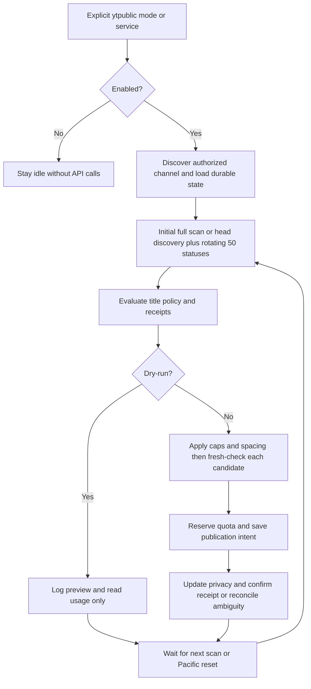

# Liverecorder

Auto-record live stream video + chat + gift from SHOWROOM and IDN Live, with automatic upload to YouTube and replay data storage to R2.

## Key Features

- **🎥 Auto-Recording**: Automatically detects and records live streams from SHOWROOM and IDN Live in real-time.
- **💬 Chat & Gift Logging**: Captures live chat and gifts, exporting them to structured NDJSON and video-synced SRT formats.
- **🔄 Auto YouTube Upload**: Automatically uploads the finalized MP4 videos to YouTube (supports resumable uploads and OAuth flow).
- **☁️ Cloud Replay Storage**: Syncs metadata, chat logs, and generated thumbnails to the backend/R2 for the web replay player.
- **🎭 Theater & News Monitor**: Continuously tracks JKT48 official news and theater schedules, sending real-time alerts to Telegram for any updates.
- **🌟 IDN Live+ Tracker**: Detects premium IDN Live+ streams and alerts via Telegram.
- **📅 Daily Schedule Reminder**: Automatically sends a summary of today's JKT48 theater/event schedules to Telegram at exactly 12:00 PM WIB.
- **⏳ Upcoming Schedule Reminder**: Sends a dynamic text notification exactly 30 minutes before a show or event begins.
- **🎂 Birthday Notifier**: Checks and sends daily birthday greetings with member photos, as well as a complete monthly birthday recap on the 1st of every month to Telegram at exactly 00:00 AM WIB.
- **💓 System Health Monitoring**: Monitors backend health status and sends Telegram alerts if downtime is detected.

## Prerequisites

| Tool | Minimum |
|------|---------|
| Python | 3.10+ |
| ffmpeg | 4.4+ (`ffmpeg -version`) |
| Backend | `make dev-be` running on `localhost:8000` |

## System Flow

The original recording, upload, theater, and heartbeat loops are shown below with the optional GDrive pipeline added. In production, `setup-recorder.sh` installs separate record, upload, theater, and GDrive services. `--mode all` runs these roles together; do not run it alongside the split services.

```mermaid
flowchart TD

    subgraph Theater["Theater Loop (Independent Checkers)"]
        T1[News, Schedule, Birthday] --> T2[(pending_notifications/)]
        T3[IDN Live+, Health] --> T2
        T2 -->|Read by| T4[Theater Watcher]
        T4 -->|Sends payload| T5[Telegram Notifier]
    end

    subgraph Recording["Recording Loop (every 10s)"]
        D[Poll GET /api/jkt48/live] --> E{Sync with active sessions}
        E -->|New live| F[Start ffmpeg HLS→MKV]
        F --> G[Start chat capture]
        G --> G1["SHOWROOM: HTTP poll comments and gifts; IDN: WebSocket IRC"]
        G1 --> G2["Start periodic screenshots: 30s and every 5 min"]
        E -->|Ended live| H[Stop ffmpeg + chats]
        H --> I[Remux MKV→MP4]
        I --> J["Generate SRT and JSON; final screenshot at 50% duration"]
        J --> K[Delete temp files log/ffmpeg.log]
        K --> L[Recording folder with metadata status:completed]
        L --> LA[Send End Live Notif]
        E -->|Still active| M{Check ffmpeg health}
        M -->|ffmpeg died OR stalled >5 min| N{Stream still live?}
        N -->|Yes| O[Restart ffmpeg]
        N -->|No| H
    end

    subgraph Upload["Upload Loop (every 10s)"]
        P[Scan recordings/] --> Q{enable_upload_queue?}
        Q -->|Yes| R[Queue Manager: Sort by size/phase]
        Q -->|No| S[Direct Processing]
        
        R --> T{Apply max_concurrent}
        T --> U[Phase 1: R2 Upload]
        S --> U
        U --> V[Generate Thumbnail & Upload Replay Data]
        V --> W{Success?}
        W -->|No| X[Retry Later]
        W -->|Yes| Y[Send Recap Notif & mark .r2_done]
        
        Y --> Route{REC_BACKUP_TO_GDRIVE?}
        Route -->|No| Z{YouTube Enabled?}
        Route -->|Yes| GBScan
        Z -->|Yes| AA[Phase 2: YouTube Upload]
        AA --> AB{Success?}
        AB -->|No| X
        AB -->|Yes| AC["PATCH Backend: youtube_id and youtube_title; send replay notification"]
        
        Z -->|No| WaitYT[Keep local folder until YouTube is configured]
        AC --> AD[Log to uploads.jsonl and remove completed folder]
        X --> P
    end

    subgraph GDrive["GDrive Service: independent backup and YouTube workers"]
        GDEnabled{REC_BACKUP_TO_GDRIVE?}
        GDEnabled -->|No| GDIdle[Service stays alive but idle]
        GDEnabled -->|Yes| GBScan[Scan completed folders with .r2_done]
        GBScan --> GBVideo{Nonempty final MP4 exists?}
        GBVideo -->|No| GBKeep[Keep all local files and log reason; do not upload]
        GBVideo -->|Yes| GBParallel["Parallel backups: REC_GDRIVE_MAX_CONCURRENT_UPLOADS"]
        GBParallel --> GBUpload[Upload MP4, original metadata and optional thumbnail]
        GBUpload --> GBVerify{All remote files verified?}
        GBVerify -->|No| GBRetry[Keep local source and retry with backoff]
        GBRetry --> GBScan
        GBVerify -->|Yes| GBReady[Write manifest and .drive_ready last]
        GBReady --> GBReceipt[Persist backup receipt and recheck source]
        GBReceipt --> GBRemove[Remove verified local recording folder]
        GBRemove --> GDStorage[(Private JKT48Live archives)]

        GDEnabled -->|Yes| GYEnabled{REC_GDRIVE_TO_YOUTUBE?}
        GYEnabled -->|No| GYStore[Backup only; do not create .yt_done]
        GYEnabled -->|Yes| GYScan[Select ready archives without .yt_done]
        GDStorage -->|Read only when Drive-to-YouTube is enabled| GYScan
        GYScan --> GYReady[Validate .drive_ready and assets; wait until local source is removed]
        GYReady --> GYPriority[Nickname priority, then largest MP4 within each group]
        GYPriority --> GYAdmit["Before download: cooldown, delay, disk space and REC_MAX_CONCURRENT_UPLOADS"]
        GYAdmit --> GYDownload[Download verified assets to gdrive-staging]
        GYDownload --> GYUpload[Call the existing shared YouTube uploader]
        GYUpload --> GYResult{YouTube upload successful?}
        GYResult -->|No| GYRetry[Preserve Drive source; clean staging and retry when eligible]
        GYRetry --> GYScan
        GYResult -->|Yes| GYCheckpoint[Persist YouTube ID; retry finalization without reupload]
        GYCheckpoint --> GYFinalize[Update backend and send eligible replay notification]
        GYFinalize --> GYDone[Write remote .yt_done with frozen retention decision]
        GYDone --> GYClean[Clean local staging]
        GYClean --> GYRetention{Recorded retention decision?}
        GYRetention -->|Keep| GYKeep[Retain completed archive; later config changes do not delete it]
        GYRetention -->|Delete| GYDelete[Permanently delete eligible Drive archive]
    end

    subgraph Heartbeat["Heartbeat Loop"]
        H1[POST /api/health/recorder] --> H2{Backend Alive?}
        H2 -->|Yes| H3[Sync Status: Active]
        H2 -->|No| H4[Log Error]
    end

    subgraph Main["main.py"]
        A[Start] --> M1[Heartbeat Loop]
        A --> M2[Recording Loop]
        A --> M3[Upload Loop]
        A --> M4[Theater Loop]
        A --> M5[GDrive Service]
    end

    LA --> P
    M1 --> H1
    M2 --> D
    M3 --> P
    M4 --> T1
    M4 --> T3
    M4 --> T4
    M5 --> GDEnabled
```



The GDrive backup and Drive-to-YouTube workers run concurrently with independent transfer clients and a dedicated backup thread pool. Incomplete Drive folders are not consumed: `.drive_ready` is committed only after verification, and the original local source must be gone before download. Theater health-checker execution is currently disabled in `main.py`; the existing checker is shown for architecture context. Loop intervals follow configuration; the 10-second labels describe the original overview.

## Directory Structure

```
recorder/
├── __init__.py
├── main.py                       # Entry point
├── auth_youtube.py               # YouTube OAuth flow (get refresh token)
├── auth_gdrive.py                # Separate Drive account OAuth and private root setup
├── requirements.txt
├── .env                          # Local config (gitignored)
├── .env.example                  # Config template
├── recordings/                   # Output (configurable via REC_RECORDINGS_DIR)
│   ├── {nickname}_{unix_ts}/     # Per-recording folder
│   │   ├── {live_id}.mkv         # Temporary (deleted after remux)
│   │   ├── {live_id}.mp4         # Final video (deleted after YT upload)
│   │   ├── {live_id}.log         # Raw chat TSV (deleted after remux)
│   │   ├── {live_id}.jsonl       # Structured chat/gift NDJSON
│   │   ├── {live_id}.srt         # Chat transcript
│   │   ├── {live_id}.json        # Metadata
│   │   ├── {live_id}.ffmpeg.log  # ffmpeg stderr (deleted after remux)
│   │   ├── {live_id}.upload_uri  # YT resume URI (deleted after upload)
│   │   ├── {live_id}_yt_thumb.jpg# Auto-generated 16:9 collage thumbnail
│   │   └── screenshots/
│   │       ├── {nickname}_{ts}.jpg
│   │       └── ...
│   └── .gitkeep
├── gdrive-staging/               # Verified temporary downloads for Drive-to-YouTube
├── logs/                         # Logs & upload history
│   ├── recorder.log
│   ├── uploader.log
│   ├── gdrive.log
│   ├── ytpublic.log             # Dedicated publication log (file mode / service output)
│   ├── ytpublic/                # Durable safety state; do not delete while active
│   │   ├── catalog.json         # Cached channel videos, pagination and rotation cursor
│   │   ├── quota.json           # Pacific-day quota/attempt ledger and spacing
│   │   └── receipts/            # Per-video publication intent and outcome
│   ├── gdrive-backups/           # Persistent verified backup receipts; no auto-pruning
│   ├── gdrive-claims/            # Persistent OS lock files; presence does not mean locked
│   ├── gdrive-jobs/              # YouTube checkpoints and retention decisions
│   └── uploads.jsonl
└── src/
    ├── __init__.py
    ├── config.py                 # Pydantic settings (REC_* env vars)
    ├── logging_config.py         # Dual logger setup (recorder + uploader)
    ├── heartbeat.py              # Heartbeat to signal process is alive
    ├── models.py                 # LiveInfo, RecordingSession dataclasses
    ├── record/
    │   ├── __init__.py
    │   ├── live_detector.py      # Polls /api/jkt48/live
    │   ├── stream_recorder.py    # ffmpeg subprocess management
    │   ├── chat_capture.py       # SHOWROOM (HTTP) + IDN (WS) chat/gift
    │   ├── srt_generator.py      # .log TSV -> .srt conversion
    │   └── manager.py            # Recording lifecycle orchestration
    ├── upload/
    │   ├── __init__.py
    │   ├── watcher.py            # Background upload pipeline
    │   ├── youtube_uploader.py   # Resumable YT upload via API
    │   ├── thumbnail_generator.py# Generates thumbnails for recordings
    │   └── r2_uploader.py        # Replay data -> backend -> R2
    ├── gdrive/
    │   ├── __init__.py
    │   ├── client.py             # Thread-isolated Drive transports
    │   ├── archive.py            # Manifest and readiness validation
    │   ├── backup_worker.py      # Parallel verified backups and local cleanup
    │   ├── youtube_worker.py     # Priority downloads; calls shared YouTube uploader
    │   ├── state.py              # Durable checkpoints
    │   └── service.py            # Config gates and worker lifecycle
    ├── ytpublic/                # Explicit-only title-based YouTube publication worker
    │   ├── __init__.py
    │   ├── policy.py             # Fail-closed classification and IDN timing
    │   ├── client.py             # Metered YouTube reads and status updates
    │   ├── state.py              # Durable catalog, quota ledger and receipts
    │   └── service.py            # Scan loop, gates, pause and reconciliation
    ├── theater/
    │   ├── __init__.py
    │   ├── news_checker.py       # Check for new JKT48 news and announcements
    │   ├── schedule_checker.py   # Daily schedule notifications at 12:00 WIB
    │   ├── birthday_checker.py   # Daily birthday notifications at 00:00 WIB
    │   ├── idn_live_plus_checker.py # Checks for premium IDN Live+ streams
    │   ├── mypage48_health_checker.py # Monitors backend health status
    │   ├── html_screenshot.py    # Playwright utility for full-page HTML capture
    │   └── watcher.py            # Monitors pending_notifications and sends them
    └── notify/
        ├── __init__.py
        ├── telegram_notifier.py  # Telegram bot integration
        └── web_screenshot.py     # Webpage screenshot utility
```

## Quick Start

```bash
# 1. From repo root
source .venv/bin/activate

# 2. Install dependencies (one-time)
pip install -r recorder/requirements.txt
playwright install chromium

# 3. (Server Linux only) Install system libraries for headless Chromium
sudo .venv/bin/playwright install-deps chromium

# 4. Run
python -m recorder.main
```

### CLI Arguments

You can pass several arguments to `recorder/main.py` for advanced control:

| Argument | Description | Example |
|----------|-------------|---------|
| `--mode {record,upload,theater,gdrive,ytpublic,all}` | Run a specific loop or `all` (default). `theater` runs the independent background checkers; `gdrive` runs config-gated backup and optional Drive-to-YouTube workers. `ytpublic` is explicit-only and is **not included in `all`**. | `python -m recorder.main --mode ytpublic` |
| `--status [folder]` | Check status of all recordings or a specific folder. | `python -m recorder.main --status` |
| `--remux [folder]` | Force remux interrupted/stuck `.mkv` files to `.mp4`. | `python -m recorder.main --remux all` |
| `--delete [folder]` | Delete all recording folders or a specific one. | `python -m recorder.main --delete oline_1782911092` |
| `-y, --yes` | Bypass confirmation prompts for destructive commands. | `python -m recorder.main --delete all -y` |

Output is in `recorder/recordings/`:

```
recorder/recordings/
├── oline_1782911092/
│   ├── ayo-ngobrol-bareng-260701223500.mp4
│   ├── ayo-ngobrol-bareng-260701223500.srt
│   ├── ayo-ngobrol-bareng-260701223500.json
│   ├── ayo-ngobrol-bareng-260701223500.jsonl
│   ├── ayo-ngobrol-bareng-260701223500_yt_thumb.jpg
│   └── screenshots/
│       ├── oline_1782911092.jpg
│       └── ...
└── ...
```

> **Note**: Recording uses `.mkv` (Matroska) so the file appears immediately and grows in real-time.
> When the session ends, it is automatically remuxed to `.mp4` (H.264 + AAC, `-movflags +faststart`).

## How It Works

1. Poll `GET /api/jkt48/live` every 10 seconds
2. New live detected → start ffmpeg + chat capture (comments + gifts)
3. Live ends → stop, remux `.mkv` → `.mp4`, generate `.srt` + `.json` + screenshots
4. Output: `.mp4` (video) + `.srt` (chat) + `.json` (metadata) + `.jsonl` (raw chat data) + `screenshots/` + `_yt_thumb.jpg` (collage)
5. **Upload pipeline**: Watcher picks up completed recordings → generate `_yt_thumb.jpg` → upload to YouTube (if configured) → upload replay data (JSONL + SRT + Thumbnails) to backend API for R2 storage → cleanup folder
6. **Theater mode**: Runs independently to monitor JKT48 News, track Schedule updates, and send automated notifications to Telegram. It also includes daily background routines:
   - **Daily Schedule Reminder**: Triggers every day at 12:00 PM WIB to summarize today's shows.
   - **Upcoming Schedule Reminder**: Triggers dynamically 30 minutes before any show or event starts.
   - **Daily Birthday Reminder**: Triggers every day at 12:00 AM WIB to congratulate members having a birthday today.
   - **Monthly Birthday Recap**: Triggers on the 1st of every month at 12:00 AM WIB to send a full list of all members celebrating their birthdays in that month.
   - **IDN Live+ Alerts**: Detects premium streams and notifies via Telegram.
   - **Health Checks**: Monitors backend health and alerts on downtime.

## Output Files

| File / Dir | Description |
|------------|-------------|
| `*.mp4` | Final video (HLS → Matroska → MP4, `-c copy`, no re-encode) |
| `*.mkv` | Temporary recording file (deleted after remux) |
| `*.log` | Raw chat log (intermediate, deleted after remux) |
| `*.jsonl` | Structured chat/gift data (NDJSON, uploaded to backend then kept) |
| `*.srt` | Chat transcript synced to video |
| `*.json` | Metadata (member, timestamps, title, youtube_id, etc.) |
| `*_yt_thumb.jpg` | Auto-generated 16:9 collage thumbnail for YouTube and R2 |
| `screenshots/` | Periodic `.jpg` captures every 5 min + final capture at 50% duration |

After successful upload to YouTube and backend, the entire folder is removed.

## Metadata JSON Format

```json
{
  "live_id": "ayo-ngobrol-bareng-260701223500",
  "status": "completed",
  "platform": "idn",
  "room_id": null,
  "room_identifier": "rbwoihikwwldms",
  "title": "Ayo ngobrol bareng!",
  "member_name": "Oline Manuel",
  "member_nickname": "Oline",
  "start_at": "2026-07-01T15:35:15Z",
  "recording_started_at": "2026-07-01T16:38:13Z",
  "recording_ended_at": "2026-07-01T16:41:25Z",
  "duration_seconds": 192,
  "srt_file": "ayo-ngobrol-bareng-260701223500.srt",
  "youtube_id": "VQw4w9WgXcK",
  "youtube_title": "LIVE IDN Oline JKT48 | 1 Juli 2026 22:35 WIB"
}
```

## SRT Format

```
1
00:00:03,500 --> 00:00:03,500
user_a: hello everyone

2
00:00:12,100 --> 00:00:12,100
[GIFT] user_b: sending gift
```

This format is 100% compatible with the `ReplayChat.svelte` parser on the frontend.

## Configuration (via .env)

| Variable | Default | Description |
|----------|---------|-------------|
| `REC_API_BASE_URL` | `http://localhost:8000/api` | Backend API URL |
| `REC_FRONTEND_BASE_URL` | `http://localhost:5173` | Frontend URL for replay links |
| `REC_POLL_INTERVAL` | `10` | Live poll interval in seconds |
| `REC_NEWS_CHECK_INTERVAL` | `300` | News check poll interval in seconds |
| `REC_SCHEDULE_CHECK_INTERVAL` | `300` | Schedule check poll interval in seconds |
| `REC_HEALTH_CHECK_INTERVAL` | `300` | Backend health check interval in seconds |
| `REC_HEARTBEAT_INTERVAL` | `120` | Heartbeat interval to signal recorder status |
| `REC_RECORDINGS_DIR` | `recorder/recordings` | Output directory |
| `REC_THEATER_DIR` | `recorder/theater` | Output directory for theater checks |
| `REC_MAX_RECORDING_HOURS` | `4` | Max recording duration |
| `REC_REMUX_TIMEOUT` | `600` | Timeout in seconds for ffmpeg remuxing |
| `REC_MAX_CONCURRENT_UPLOADS` | `2` | Max concurrent uploads for R2/YouTube |
| `REC_ENABLE_UPLOAD_QUEUE` | `True` | Enable size/phase based upload priority queue |
| `REC_YOUTUBE_UPLOAD_DELAY_MINUTES`| `30` | Delay before uploading to YouTube after R2 |
| `REC_SHOWROOM_COMMENT_INTERVAL` | `2.0` | SHOWROOM comment poll interval |
| `REC_SHOWROOM_GIFT_INTERVAL` | `5.0` | SHOWROOM gift poll interval |
| `REC_LOG_LEVEL` | `INFO` | Logging level |
| `REC_LOG_MODE` | `stdout` | Log output: `stdout` or `file` |
| `REC_LOGS_DIR` | `recorder/logs` | Log storage directory |
| `REC_REPLAY_API_URL` | `/admin/replay/upload` | Backend endpoint for replay upload |
| `REC_API_KEY` | `""` | Admin API key for replay upload |
| `REC_GOOGLE_CLIENT_ID` | `""` | Google OAuth client ID (YouTube upload) |
| `REC_GOOGLE_CLIENT_SECRET` | `""` | Google OAuth client secret |
| `REC_YOUTUBE_REFRESH_TOKEN` | `""` | YouTube refresh token |
| `REC_YOUTUBE_PRIVACY_STATUS` | `unlisted` | YouTube video privacy (`public`, `unlisted`, `private`) |
| `REC_YOUTUBE_UPLOAD_PRIORITY` | `""` | Comma-separated member nicknames in YouTube queue priority order; no nickname count limit |
| `REC_TELEGRAM_ENABLED` | `True` | Turn Telegram notifications on/off. Also gates the heartbeat credentials, so when `false` the backend stops sending recorder down/up alerts too. |
| `REC_TELEGRAM_BOT_TOKEN` | `""` | Telegram Bot Token for notifications |
| `REC_TELEGRAM_CHAT_ID` | `""` | Telegram Chat/Channel ID for notifications |
| `REC_PAGE48_ENABLED` | `False` | Also cross-post notifications to the Page48 feed |
| `REC_PAGE48_API_KEY` | `""` | Page48 official account API key (`ffk_...`) |
| `REC_PAGE48_BASE_URL` | `""` | Override API base URL for Page48 (defaults to `REC_API_BASE_URL`) |

## Platform Support

| Platform | Stream Source | Chat Method |
|----------|--------------|-------------|
| SHOWROOM | HLS via `/api/jkt48/live/showroom/{id}/streaming-url` (uses `room_id`, picks highest quality) | HTTP poll `comment_log` + `gift_log` API every 2s / 5s |
| IDN Live | HLS via `/api/jkt48/live/idn/{slug}/streaming-url` (uses `live_id`) | WebSocket IRC `wss://chat.idn.app/` |

## Upload Pipeline

After a recording ends (`status: "completed"` in metadata), a background **Watcher** processes it using a two-phase concurrency-limited queue system:

1. **Phase 1 (R2 Upload)**: Generates a thumbnail, uploads replay data (`.jsonl`, `.srt`, screenshots) to the backend API/R2, sends a Recap Telegram notification, and marks `.r2_done`.
2. **Phase 2 (YouTube Upload)**: If configured, waits for any defined delay (`REC_YOUTUBE_UPLOAD_DELAY_MINUTES`), then uploads the `.mp4` to YouTube (supports resumable uploads). Once successful, it updates the backend with the YouTube ID and sends a Replay Telegram notification.
3. **Queue & Cleanup**: Processing can use an upload queue (`REC_ENABLE_UPLOAD_QUEUE`) to prioritize uploads by file size and is limited by `REC_MAX_CONCURRENT_UPLOADS`. On full success, the folder is deleted and tracked in `logs/uploads.jsonl`.

### YouTube upload priority

With `REC_ENABLE_UPLOAD_QUEUE=true`, optionally set:

```dotenv
REC_YOUTUBE_UPLOAD_PRIORITY=erine,oline,fritzy,
```

YouTube candidates are ordered by nickname priority first, then largest MP4 within each member's group: all Erine videos, all Oline videos, all Fritzy videos, then all remaining members together by largest MP4. Matching uses metadata `member_nickname`, ignores case and surrounding whitespace, and skips empty entries (including a trailing comma). Duplicate nicknames retain their first position; there is no limit on the number of nicknames.

Members without ready videos are skipped without waiting. An empty setting preserves largest-MP4-first ordering. R2 ordering is unchanged. Priority applies when candidates are queued; it does not interrupt running uploads or reorder tasks already waiting for an upload slot. Restart the recorder after changing the configuration.

## Google Drive buffer (optional)

The optional Drive pipeline runs in the separate `mypage48-gdrive.service` installed by `setup-recorder.sh`. Drive-specific code lives in `src/gdrive/`; video uploads reuse the existing YouTube uploader.

```dotenv
REC_BACKUP_TO_GDRIVE=false
REC_GDRIVE_TO_YOUTUBE=false
REC_GDRIVE_REFRESH_TOKEN=
REC_GDRIVE_MAX_CONCURRENT_UPLOADS=1
REC_GDRIVE_DELETE_AFTER_YOUTUBE_UPLOAD=false
REC_GDRIVE_KEEP_MEMBERS=erine,oline
```

Authorize the storage account with `python recorder/auth_gdrive.py` from the repository root. It uses the existing Google client ID/secret, allows selecting an account different from YouTube, and creates/reuses a private `JKT48Live` folder automatically. First enable **Google Drive API** in the same OAuth project, then open **Google Auth Platform → Data Access → Add or remove scopes**, check `https://www.googleapis.com/auth/drive.file`, click **Update**, and **Save**. Keep both YouTube scopes selected. Filtering for a scope does not select its checkbox. The existing YouTube token does not need to be replaced; save the new token separately as `REC_GDRIVE_REFRESH_TOKEN`. No folder ID is configured. See [the step-by-step authentication guide](../docs/RECORDER_GDRIVE_FEATURE.md#google-cloud-setup).

- Master disabled: the GDrive service remains alive but idle; normal uploads are unchanged.
- Master enabled, Drive-to-YouTube disabled: backup verified post-R2 videos to Drive, then remove local sources. Do not mark them YouTube-completed.
- Both enabled: additionally select pending Drive archives by `REC_YOUTUBE_UPLOAD_PRIORITY` and descending MP4 size, download within concurrency/disk limits, and upload using the existing YouTube implementation.
- `REC_GDRIVE_MAX_CONCURRENT_UPLOADS` bounds real parallel backup jobs/transfers independently of `REC_MAX_CONCURRENT_UPLOADS`, which bounds Drive-to-YouTube jobs. Thread-isolated API transports and a dedicated backup pool let both pipelines transfer concurrently, subject to server, network, and API capacity.
- Backup requires `.r2_done`, completed metadata, and a nonempty final MP4. MKV-only, missing-video, and empty-MP4 folders remain on the server with an explanatory log, without any Drive upload.
- Backup activity logs show `IDLE` once when no eligible folders remain, `START` for each actual job with the last observed idle time, and `WAIT` when sources need retry/recovery. These are transitions, not per-scan heartbeat messages; Drive-to-YouTube remains independent.
- Drive-to-YouTube ignores incomplete archives: `.drive_ready` must be valid, all files must match the manifest, and the original local source must already be removed.
- Retained completed folders contain `.yt_done` and are never uploaded again. Retention decisions are non-retroactive: removing a nickname exception does not delete its previously retained folders.
- Deletion is permanent when enabled and allowed; start with it disabled.
- Invalid Drive OAuth credentials pause both Drive pipelines with one CRITICAL log. The service stays alive without repeated authentication requests; fix the credentials and restart `mypage48-gdrive` to resume. Network/transient errors still retry with backoff.

Run locally with `python -m recorder.main --mode gdrive`. Restart the GDrive service after changing its settings; when changing the master routing switch, safely drain and restart both upload and GDrive services. The initial deployment must also restart the record service to load the recording/cleanup coordination code. Do not run `--mode all` alongside split services.

See [the detailed feature guide](../docs/RECORDER_GDRIVE_FEATURE.md) for setup, recovery, service commands, and limitations, and [the implementation plan](../docs/RECORDER_GDRIVE_IMPLEMENTATION_PLAN.md) for architecture and acceptance criteria.

### Local Drive state and temporary folders

- `logs/gdrive-backups/` stores verified-backup receipts used to validate local cleanup/recovery. They remain after success; they are not YouTube completion markers.
- `logs/gdrive-claims/` contains per-live recording/backup lock files. Files remain after the OS lock is released; their existence does not indicate an active job. Never delete lock files while recorder/backup processes are running.
- `logs/gdrive-jobs/` stores pending YouTube checkpoints, including known video IDs and resumable sessions. Successful completed-archive cleanup removes the corresponding checkpoint; failures keep recovery state.
- `gdrive-staging/` contains temporary downloads, not permanent backups. The worker verifies downloads and cleans staging after jobs; durable checkpoints live outside it.

Receipts and claim files currently have **no automatic expiry/pruning**, so file counts can grow even though they contain no video payloads. Manual bulk deletion is not recommended; stop relevant processes and preserve incomplete recovery state before maintenance. See [local folders and safe cleanup](../docs/RECORDER_GDRIVE_FEATURE.md#local-folders-state-files-and-cleanup) for lifecycle and precautions.

## FAQ

**Q: No video output?**
A: Make sure the backend is running (`make dev-be`) and a member is live.

**Q: ffmpeg error?**
A: Run `ffmpeg -version` to verify installation. Minimum version 4.4.

**Q: Only chat recorded, video is empty?**
A: Check the HLS URL from the `streaming-url` endpoint. The platform may be having issues.

**Q: Want to change output directory?**
A: Set `REC_RECORDINGS_DIR` in `.env` or as an environment variable.

**Q: How to enable YouTube upload?**
A: Follow the [YouTube Upload Setup](#youtube-upload-setup) steps below.

**Q: Why are some videos uploaded as YouTube Shorts?**
A: Due to a recent YouTube update, all vertical videos (like IDN Live) under 3 minutes are automatically classified as Shorts. Horizontal videos (like Showroom) remain regular videos regardless of length.

**Q: How to skip specific members?**
A: (Not yet implemented — currently records all active streams.)

## YouTube Upload Setup

### 1. Create OAuth Client ID

1. Go to [Google Cloud Console](https://console.cloud.google.com/)
2. Create a new project or select an existing one
3. Enable **YouTube Data API v3** (APIs & Services → Library)
4. Go to **Credentials**, click **Create Credentials** → **OAuth client ID**
5. Application type: **Desktop app**
6. Add `http://localhost` to **Authorized redirect URIs**
7. Copy the **Client ID** and **Client Secret**

### 2. Set environment variables

```bash
# In recorder/.env
REC_GOOGLE_CLIENT_ID=xxxxx.apps.googleusercontent.com
REC_GOOGLE_CLIENT_SECRET=GOCSPX-xxxxx
```

### 3. Generate refresh token

```bash
python -m recorder.auth_youtube
```

This opens a browser window asking you to log in to Google and authorize access.
After authorizing, the script prints the refresh token. Add it to `.env`:

```bash
REC_YOUTUBE_REFRESH_TOKEN=1//0xxxxx
REC_YOUTUBE_PRIVACY_STATUS=unlisted
```

The script (`recorder/auth_youtube.py`) handles the OAuth desktop flow locally
and requests the `youtube.upload` scope.

### 4. Publish OAuth consent screen (required for permanent token)

By default, your OAuth consent screen is in **Testing** mode — refresh tokens
expire after **7 days**. To get a permanent token:

1. Go to **APIs & Services → OAuth consent screen** in Google Cloud Console
2. Click **Publish App** under *Publishing status*
3. Scope `youtube.upload` is sensitive — Google may require verification.
   Workaround if the app is for personal use: remove any logo from the consent
   screen and fill in the required fields (support email, privacy policy link
   can be a placeholder). The status may change to *Verification not required*
   if only non-sensitive scopes remain, allowing you to publish without review.

> **Without publishing, you must re-run `auth_youtube.py` every 7 days** to
> get a fresh token.

## Telegram Notification Setup

To receive real-time notifications when a live stream starts or ends (with screenshots), you can configure a Telegram Bot.

### 1. Create a Telegram Bot

1. Open Telegram and search for **@BotFather** (https://t.me/botfather).
2. Send the command `/newbot`.
3. Follow the instructions to choose a name and username for your bot.
4. Once created, BotFather will give you an **API Token**. Copy this token.

### 2. Get the Chat or Channel ID

1. Create a new Telegram Channel (or Group) where you want to receive the notifications.
2. Add your newly created bot to the Channel as an **Administrator** so it has permission to send messages and media.
3. **If your channel is Public:**
   You can simply use your channel's username with an `@` symbol.
   Example: `REC_TELEGRAM_CHAT_ID=@mypage48_live`
4. **If your channel is Private:**
   Private channels don't have usernames, so you need the numeric ID (usually starts with `-100`). The easiest way to get it:
   - Login to Telegram via Web (`web.telegram.org/a/` or `/k/`).
   - Open your channel there.
   - Check the URL in your browser. It will look something like this: `https://web.telegram.org/a/#-1001234567890`.
   - Copy the numbers starting from `-100...`
   - Example: `REC_TELEGRAM_CHAT_ID=-1001234567890`

### 3. Set environment variables

Add the credentials to your `recorder/.env` file:

```bash
# In recorder/.env
REC_TELEGRAM_BOT_TOKEN=1234567890:ABCdefGHIjklxxxxxzzzxxxxxxzzzzzz
REC_TELEGRAM_CHAT_ID=-1001234567890
```

## Page48 Notification Setup

When enabled, every notification the recorder sends to Telegram is also posted
to your own Page48 feed (`/jkt48/page48`). Telegram keeps working unchanged; the
Page48 post is best-effort and never blocks the Telegram delivery. Captions are
converted to plain text and split into a thread when longer than the 500-character
post limit, and the same images (screenshots, live cover, replay thumbnail) are
uploaded to storage and attached to the first post.

### 1. Create the official account

The recorder posts as a **dedicated Page48 account**, not an admin account:

1. Register a normal account for the recorder (e.g. a "MyPage48" bot account).
2. Ask an admin to set its `page48AccountType` to `official_account` so it shows
   the official check mark.
3. Sign in as that account and generate its API key (Account settings → API Keys).

### 2. Set environment variables

```bash
# In recorder/.env
REC_PAGE48_ENABLED=true
REC_PAGE48_API_KEY=ffk_xxxxxxxxxxxxxxxxxxxxxxxxxxxxxxxx
# Optional: only needed if Page48 lives on a different backend than REC_API_BASE_URL
# REC_PAGE48_BASE_URL=https://mypage48.com/api
```

## Standalone YouTube publication (`ytpublic`)

See the [ytpublic operational guide](../docs/RECORDER_YTPUBLIC_FEATURE.md) for all configuration fields, quota/state details, rollout, credentials and manual reconciliation. The implementation has **not been runtime-verified against the live YouTube API**.

Run from the repository root with the existing virtualenv active:

```bash
python -m recorder.main --mode ytpublic
```

This explicit mode (or `mypage48-ytpublic.service`) is the only way to start the worker. **`all` is unchanged and does not include ytpublic.** The setup script installs/enables the dedicated unit alongside the other services; review its broader effects before rerunning it. Disabled by default, the worker stays alive and idle without YouTube calls. Restart only ytpublic after changing configuration:

```bash
sudo systemctl status mypage48-ytpublic.service
sudo systemctl restart mypage48-ytpublic.service
sudo systemctl stop mypage48-ytpublic.service
```

### Publication rules and safety

- Uses only YouTube titles/current status and independent safety state, not recorder metadata, backend history, Drive manifests, staging or upload history. No uploads, source deletion, or changes to other workers/cooldowns.
- Member IDN titles must match the complete Indonesian weekday/date/time format ending in `WIB`. Eligibility is **title start + 72 hours + 8-hour buffer** (80 hours by default). **Actual live end is not known**: the buffer assumes the live ends within eight hours; longer lives are not guaranteed 72 hours after their actual end. This is an operator-selected approximation, not verified policy compliance.
- Private titles with standalone `SHOWROOM` anywhere are immediately eligible without date parsing (`MYSHOWROOM` does not match), **subject to all caps, spacing and budget limits**. Mixed standalone IDN/SHOWROOM titles fail closed.
- Unlisted/public/unknown status, existing publication schedules, exclusions and successful receipts are skipped. Unsupported or malformed IDN titles fail closed.
- Initial discovery scans the full uploads playlist in pages/batches. Subsequent scans inspect the head for new uploads and refresh a rotating batch of up to **50 known statuses per scan** to limit reads. Older edits on large channels may wait for rotation, but **every real candidate gets a fresh title/status check after spacing and before updating**. Cached pending retries never authorize updates from stale status alone. Dry-run previews may use cached data.
- Defaults: **80 attempted updates/day**, **5/scan**, **30 seconds between attempts**, **5,000 estimated units/day** for all worker Data API reads and updates, including dry-run, pagination, reconciliation and pre-update checks. Failed/ambiguous attempts count conservatively. Pacific midnight resets use `America/Los_Angeles` with DST, independently of server timezone. Local accounting is not the project's remaining Google quota.

Start with `REC_YTPUBLIC_ENABLED=true` and **`REC_YTPUBLIC_DRY_RUN=true`**, review the completed initial scan and intentionally private exceptions, and compare usage with Google Cloud Console. Only then disable dry-run and restart for an approved safe-to-publish candidate. Dry-run does no privacy updates, but still spends read quota and persists local state. Stopping/disabling does not revert public videos.

Reuse `REC_GOOGLE_CLIENT_ID`, `REC_GOOGLE_CLIENT_SECRET` and `REC_YOUTUBE_REFRESH_TOKEN`; **no new auth script or scope is needed** with the existing YouTube authorization. Invalid authorization emits a CRITICAL message and pauses until credentials are corrected and this service is restarted. State/safety errors also require manual review; an active process does not imply a healthy scan loop.

`REC_LOG_MODE=file` writes `<REC_LOGS_DIR>/ytpublic.log`; `stdout` writes to stdout, which the installed systemd unit redirects to its configured ytpublic log file. Unit redirection does not automatically follow a changed `REC_LOGS_DIR`. Inspect logs for `SCAN`, `WAIT`, `SKIP`, `DRY-RUN`, `PUBLIC`, `SUMMARY`, quota pauses and reconciliation warnings.

Durable `<REC_LOGS_DIR>/ytpublic/` contains `catalog.json`, `quota.json`, `.lock` and `receipts/<video_id>.json` regardless of log mode. **Do not delete, move or edit state/locks while active**, or treat them as disposable logs. Preserve across deployments: receipts prevent republication after a manual return to private, and the ledger preserves limits across restart. Ambiguous `publishing`/`needs_reconciliation` outcomes are checked by reads; public confirms success, otherwise no blind retry occurs. Stop the worker, back up state and follow the guide's manual review procedure; never reset the whole ledger/receipt folder to force retries.

### Separate standalone flow (not part of `all`)

The existing loop diagrams above remain unchanged. This additional worker is independent:


